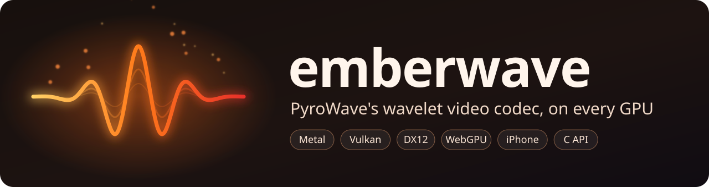
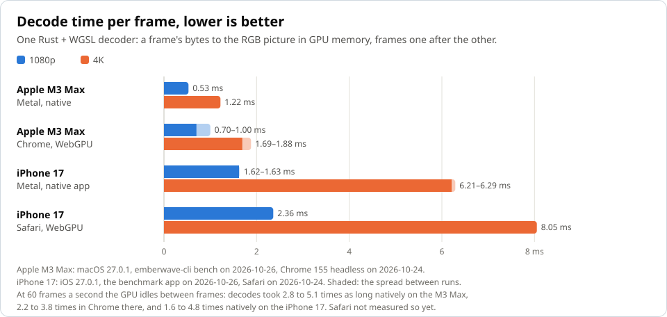
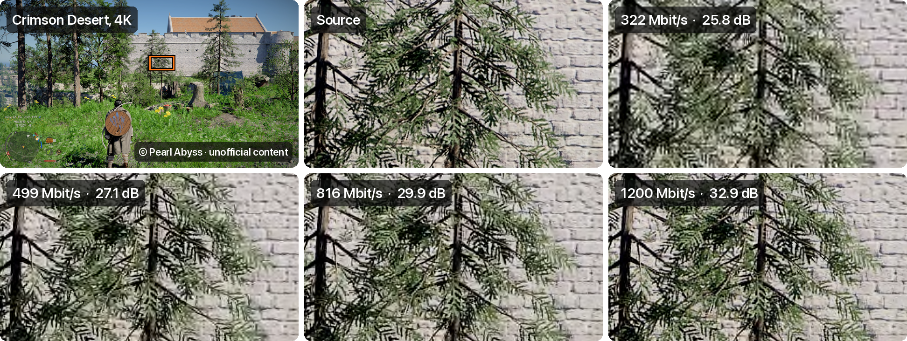
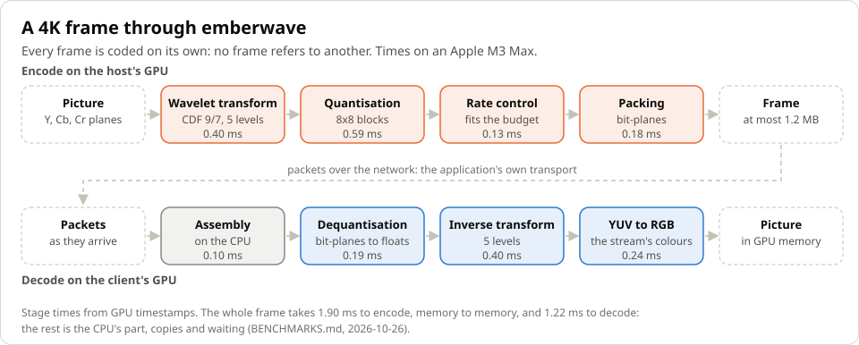
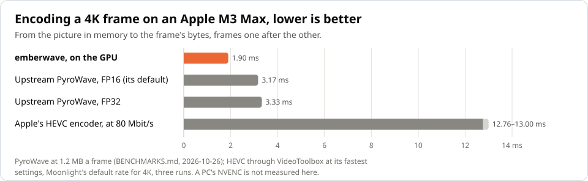

<p align="center"><a href="README.md">English</a> | <b>한국어</b></p>

<p align="center">
  
</p>

<p align="center">
  <a href="https://github.com/with-developer/emberwave/actions/workflows/ci.yml"></a>
  <a href="https://github.com/with-developer/emberwave/releases/latest"></a>
  <a href="LICENSE"></a>
  <a href="https://with-developer.github.io/emberwave/"></a>
</p>

<p align="center">
  <b><a href="https://with-developer.github.io/emberwave/">브라우저에서 스트림 재생</a></b> ·
  <a href="https://with-developer.github.io/emberwave/bench.html">내 기기로 벤치마크</a> ·
  <a href="BENCHMARKS.md">벤치마크</a> ·
  <a href="crates/emberwave-ffi/README.md">C API</a> ·
  <a href="crates/emberwave-ffi/examples/ios">iPhone 앱</a>
</p>

[PyroWave](https://github.com/Themaister/pyrowave)는 로컬 네트워크에서 게임을 스트리밍하는 데 쓰는 비디오 코덱입니다. 대역폭을 넉넉히 쓰는 대신, GPU로 프레임 하나를 1~2 ms 안에 인코딩하고 디코딩합니다. Valve는 이 코덱을 Steam 클라이언트 베타의 Steam Remote Play에 도입했습니다([GamingOnLinux](https://www.gamingonlinux.com/2026/10/steam-client-beta-for-october-1st-brings-many-remote-play-pyrowave-improvements/)). 원본 구현(이하 업스트림)은 Vulkan 컴퓨트 셰이더로 작성되어 있고, 별도의 Metal 포트도 있습니다. **emberwave는 PyroWave를 [wgpu](https://wgpu.rs) 위에서 Rust와 WGSL로 새로 구현한 것입니다.** 코드 하나로 같은 비트스트림을 Metal, Vulkan, DX12, WebGPU에서 처리하므로, 네이티브 앱은 물론 브라우저 탭과 iPhone에서도 돌아갑니다.

- **빠릅니다.** Apple M3 Max에서 프레임을 연달아 처리하면 4K 프레임 하나를 YUV 평면으로 0.90 ms, RGB로 1.22 ms에 디코딩하고, GPU에서는 CPU 메모리의 평면에서 CPU 메모리의 프레임까지 1.90 ms에 인코딩합니다. 업스트림의 Metal 포트는 같은 FP32 정밀도에서 0.80 ms, 기본값인 FP16에서 0.56 ms에 디코딩하고, 인코딩에는 3.2~3.3 ms가 걸립니다([`BENCHMARKS.md`](BENCHMARKS.md), 2026-10-26 측정).
- **프레임마다 독립적입니다.** 다른 프레임을 참조하는 프레임이 없습니다. 그래서 패킷을 잃어도 잃는 것은 많아야 그 프레임 하나이고, 키프레임을 기다릴 필요도 없습니다. 잃은 패킷에 가장 거친 레벨이나 프레임 헤더가 들어 있지 않았다면, emberwave의 프레임은 일부만이라도 화면에 보여 줄 수 있습니다. 모든 프레임은 정해진 바이트 예산을 넘지 않습니다.
- **업스트림과 양방향으로 호환됩니다.** 업스트림 인코더로 만든 스트림을 업스트림 디코더와 같은 결과(PSNR 64 dB 이상)로 디코딩하고, 업스트림 디코더도 emberwave가 만든 스트림을 읽습니다. 프레임당 바이트 수가 같을 때, 두 인코더가 공통으로 최소화하는 대비 감도로 가중한 오차는 emberwave 쪽이 업스트림 인코더(2026년 10월에 레이트 컨트롤을 고친 버전)보다 6.5~13% 적습니다. 노이즈만은 예외로, 두 인코더의 차이가 1% 안입니다. luma PSNR 차이는 그림에 따라 그러데이션의 −0.8 dB부터 테스트 장면의 +2.3 dB까지 걸쳐 있고, 노이즈에서는 차이가 없습니다.
- **네이티브 앱, 브라우저, iPhone 어디서나.** 명령줄 도구가 있고, [브라우저 플레이어](https://with-developer.github.io/emberwave/)는 페이지 안에서 WebGPU로 디코딩합니다. 플레이어는 스스로 인코딩한 데모 스트림으로 시작하며, 네트워크에서처럼 패킷이 하나씩, 순서가 뒤섞이고 일부가 사라진 채로 들어와도 스트림을 재생합니다. C API는 Linux·Windows(x86_64)와 macOS(Apple silicon)용으로 미리 빌드한 라이브러리를 함께 제공하고, iPhone·iPad·Mac 앱을 위한 XCFramework도 있습니다. Apple GPU에서 테스트했고, CI에서는 소프트웨어 Vulkan과 DX12로 테스트합니다.

<picture>
  <source media="(prefers-color-scheme: dark)" srcset="docs/images/decode-dark.svg">
  
</picture>

위 수치는 프레임을 쉬지 않고 연달아 처리할 때의 시간입니다. 실제 스트림에서는 프레임이 초당 60개씩 들어오고, 그 사이에 쉬는 GPU가 속도를 낮추기 때문에 디코딩 한 번에 시간이 더 걸립니다([성능](#성능)).

> **상태: 0.x.** 비트스트림은 업스트림의 것을 따르지만, Rust API와 C API는 마이너 버전이 바뀔 때 아직 달라질 수 있습니다. CI는 모든 변경을 Linux(lavapipe Vulkan 드라이버), macOS(Metal), Windows(WARP 위의 DX12)에서 테스트합니다. 릴리스별 변경 사항은 [`CHANGELOG.md`](CHANGELOG.md)에 있습니다.

## 화질

<p align="center">
  
</p>

PyroWave는 대역폭을 더 쓰는 대신 속도를 얻습니다. 필요한 대역폭은 그림에 따라 크게 달라집니다. 위의 4K 게임 화면은 상당 부분이 풀과 솔잎, 돌이라 압축하기 어려운 그림입니다. 패널의 프레임은 모두 emberwave 인코더로 인코딩했고, 디코딩한 패널마다 초당 60프레임 기준 비트레이트와 프레임 전체의 luma PSNR을 적었습니다. 두 배로 확대한 곳은 화질이 가장 많이 떨어지는 영역입니다. 322 Mbit/s에서는 솔잎이 뭉개지고 벽의 이음매가 흐려집니다. 816 Mbit/s에서는 대부분 되살아나고, 1.2 Gbit/s에서는 원본에 가까워집니다. 반면 벤치마크용 합성 4K 장면의 첫 그림은 322 Mbit/s에서도 42.7 dB를 유지합니다. 같은 게임 프레임을 Apple 하드웨어 HEVC 인코더로, 실시간 모드를 쓰지 않고 키프레임 하나로 만들면 같은 예산에서 luma PSNR이 emberwave보다 1.9~3.5 dB 높습니다(Apple M3 Max, macOS 27.0.1, 2026-10-27). 게다가 HEVC 스트림은 시작할 때와 손실 뒤에만 키프레임이 필요합니다. PyroWave는 대역폭이 넉넉한 로컬 네트워크를 위한 코덱입니다([`BENCHMARKS.md`](BENCHMARKS.md#picture-quality)).

<sub>프레임은 붉은사막(Crimson Desert)의 것이며 © Pearl Abyss입니다. 본 콘텐츠는 펄어비스의 공식 자료가 아니며, 본 콘텐츠에는 펄어비스가 권리를 보유하고 있는 상표 또는 저작물이 포함되어 있습니다. 펄어비스가 만들거나 보증한 것이 아닙니다. 이 그림에는 이 저장소의 라이선스가 적용되지 않습니다.</sub>

## 작동 방식

<picture>
  <source media="(prefers-color-scheme: dark)" srcset="docs/images/pipeline-dark.svg">
  
</picture>

프레임은 그림을 웨이블릿 변환한 결과입니다. 변환 계수를 블록 단위로 양자화한 뒤 비트 평면으로 나누어, 최상위 비트부터 보냅니다. 프레임을 예산에 맞출 때 인코더는 화질을 가장 덜 해치는 곳에서부터 하위 비트 평면을 버리는데, 이때 대역마다 사람 눈이 얼마나 민감한지를 가중치로 씁니다. 위 도식에 나온 단계는 디코더의 패킷 조립을 빼면 모두 WGSL 컴퓨트 셰이더로 실행됩니다. 조립은 업스트림 디코더와 마찬가지로 CPU에서 합니다. 이 단계들의 앞뒤로 CPU는 평면을 GPU로 올리고, 완성된 프레임을 받아 오고, 그림의 헤더를 복사합니다. 비트스트림 구조와 각 패스, 그리고 설계 결정의 배경은 [`ARCHITECTURE.md`](ARCHITECTURE.md)에 있습니다.

## 빠른 시작

[Rust](https://rustup.rs) 1.87 이상, 그리고 Vulkan·Metal·DX12 중 하나를 지원하는 GPU가 필요합니다. GPU가 없어도 소프트웨어 드라이버로 실행할 수 있습니다. Linux에서는 Mesa의 lavapipe(Debian과 Ubuntu에서는 `sudo apt install mesa-vulkan-drivers libvulkan1`로 설치), Windows에서는 기본으로 들어 있는 WARP를 쓰면 됩니다.

```sh
git clone https://github.com/with-developer/emberwave.git
cd emberwave
cargo build --release -p emberwave-cli
target/release/emberwave-cli decode testdata/gradient_200x120_420.pwv1 --out-dir out
```

처음 빌드할 때는 몇 분이 걸립니다. 마지막 명령은 사용 중인 어댑터와 프레임별 시간을 출력하고, 색 그러데이션 그림 `out/gradient_200x120_420_000000.png`부터 `000002.png`까지를 만듭니다. `testdata/`의 `.pwv1` 파일은 업스트림 인코더로 만든 작은 스트림입니다.

Rust가 없다면 [릴리스](https://github.com/with-developer/emberwave/releases)에서 Linux(x86_64), macOS(Apple silicon), Windows(x86_64)용 `emberwave-cli`를 내려받아 `testdata/`의 `.pwv1` 파일을 디코딩해 보면 됩니다. macOS 바이너리는 서명이 없으므로, 내려받은 뒤 `xattr -d com.apple.quarantine emberwave-cli`를 한 번 실행하세요.

## 사용법

`emberwave-cli`는 PWV1 형식(`.pwv1`)의 PyroWave 파일을 디코딩합니다. 아래 예제는 `emberwave-cli`가 `PATH`에 있다고 가정합니다. `cargo install --path crates/emberwave-cli`로 설치하거나, `target/release/emberwave-cli`를 직접 실행하세요.

```sh
# 파일 정보 보기
emberwave-cli info testdata/gradient_200x120_420.pwv1

# 프레임마다 PNG 한 장으로, 또는 YUV 평면을 담은 Y4M 비디오로 디코딩
emberwave-cli decode testdata/gradient_200x120_420.pwv1 --out-dir out
emberwave-cli decode testdata/gradient_200x120_420.pwv1 --out-dir out --format y4m

# 디코딩 시간 측정. --output rgb는 색 변환까지 포함하고, --json은 결과를 JSON으로 출력
emberwave-cli bench testdata/gradient_200x120_420.pwv1 --output rgb

# 두 Y4M 파일을 평면별로 비교. PSNR이 60 dB 미만인 평면이 있으면 실패
emberwave-cli compare out/gradient_200x120_420.y4m testdata/gradient_200x120_420.ref.y4m --min-psnr 60

# Y4M 비디오(8비트 4:2:0 또는 4:4:4)를 프레임당 6000바이트 이내로 인코딩.
# --gpu를 주면 GPU에서 인코딩
emberwave-cli encode testdata/encoder/scene_200x120_420.source.y4m --out scene.pwv1 --bytes-per-frame 6000 --gpu

# 어떤 인코더가 만든 스트림이든 원본과 비교해 화질 측정:
# PSNR, 그리고 인코더의 레이트 컨트롤이 최소화하는 오차
emberwave-cli quality testdata/encoder/scene_200x120_420.source.y4m scene.pwv1

# 인코딩 시간 측정(여기서는 GPU)
emberwave-cli bench-encode testdata/encoder/scene_200x120_420.source.y4m --bytes-per-frame 6000 --gpu
```

디코더와, `--gpu`를 준 인코더는 기기의 GPU를 사용합니다. Vulkan, Metal, DX12는 물론 Mesa의 lavapipe나 Windows의 WARP 같은 소프트웨어 드라이버도 됩니다. `--backend vulkan|metal|dx12`, `--software`, 환경 변수 `EMBERWAVE_BACKEND`로 쓸 어댑터를 좁힐 수 있고, 실제로 쓰는 어댑터는 출력에 나옵니다. RGB 변환은 파일에 적힌 정보(행렬, 범위, 크로마 위치)를 따르며, `--matrix bt601|bt709|bt2020`과 `--range full|limited`로 바꿀 수 있습니다. 전체 옵션과 시간 측정 방법은 [`ARCHITECTURE.md`](ARCHITECTURE.md#command-line-tool)를 보세요.

### C에서 쓰기

C API를 쓰면 클라이언트는 패킷을 받는 대로 넘겨 호출자의 메모리에 디코딩하고, 호스트는 보낼 그림을 프레임과 패킷으로 인코딩합니다. 헤더 `crates/emberwave-ffi/include/emberwave.h`와 공유·정적 라이브러리로 이루어지며, 릴리스마다 미리 빌드한 라이브러리도 올라갑니다. 빌드와 링크 방법은 [`crates/emberwave-ffi/README.md`](crates/emberwave-ffi/README.md)에 있고, [`examples/c/decode.c`](crates/emberwave-ffi/examples/c/decode.c)와 [`examples/c/encode.c`](crates/emberwave-ffi/examples/c/encode.c)는 완전한 예제 프로그램입니다. Linux, Android, Windows에서는 클라이언트의 Vulkan 장치 위에서 돌며 그 이미지에 디코딩할 수 있고, Windows에서는 Direct3D 12·11 장치와 텍스처·펜스를 공유합니다. 호스트는 텍스처에 담긴 그림을 그대로 인코딩하며, 캡처한 RGB 그림도 받습니다([C API의 GPU 연동](crates/emberwave-ffi/README.md#a-context-on-the-clients-vulkan-device)).

iPhone, iPad, Mac 앱을 위해서는 릴리스마다 정적 라이브러리를 XCFramework(`Emberwave.xcframework`)로도 제공하며, Swift에서는 `import Emberwave`로 씁니다. Metal 클라이언트는 그림을 GPU 텍스처 한 장에 그리게 하거나 Y, Cb, Cr 평면을 텍스처 세 장에 담게 한 뒤, 그 `id<MTLTexture>`를 읽을 수 있습니다([GPU의 그림](crates/emberwave-ffi/README.md#pictures-on-the-gpu-metal)). [`examples/swift`](crates/emberwave-ffi/examples/swift)는 이 프레임워크로 Swift에서 파일을 디코딩하는 예제이고, [`examples/ios`](crates/emberwave-ffi/examples/ios)는 iPhone·iPad용 벤치마크 앱입니다. CI는 예제와 앱을 이 프레임워크로 iOS 시뮬레이터에서 실행합니다([iPhone, iPad, Mac 앱](crates/emberwave-ffi/README.md#iphone-ipad-and-mac-apps)).

## 성능

<!-- bench-summary:begin (scripts/bench.sh가 생성합니다. 고쳐도 덮어씁니다) -->
Apple M3 Max(Metal)에서 2026-10-26에 측정한 프레임당 디코딩 시간입니다. RGB 출력은 GPU 메모리에 둔 채로 쟀고, 단위는 밀리초입니다.

| 스트림 | 평균 | p99 |
|---|---|---|
| 1080p | 0.53 | 0.79 |
| 1440p | 0.69 | 0.97 |
| 4K | 1.22 | 1.62 |

같은 기기에서는 업스트림의 Metal 디코더가 emberwave보다 빠릅니다. 4K 프레임 하나를 평면까지 디코딩하는 데 업스트림은 FP32로 0.80 ms, emberwave는 0.90 ms가 걸립니다. 측정 방법과 전체 결과는 [`BENCHMARKS.md`](BENCHMARKS.md)에 있습니다.

4K 프레임 하나를 1.2 MB 이내로 인코딩하는 데는 GPU에서 1.90 ms가 걸립니다. CPU 메모리의 평면을 받아 CPU 메모리에 프레임을 내놓기까지의 시간이며, 업스트림 인코더는 같은 구간에서 FP32로 3.33 ms가 걸립니다.
<!-- bench-summary:end -->

<picture>
  <source media="(prefers-color-scheme: dark)" srcset="docs/images/encode-dark.svg">
  
</picture>

iPhone 17의 Safari에서는 [벤치마크 페이지](https://with-developer.github.io/emberwave/bench.html)가 1080p 프레임을 2.4 ms, 4K 프레임을 8.1 ms에 GPU 메모리의 RGB로 디코딩합니다([`BENCHMARKS.md`](BENCHMARKS.md#in-the-browser-phones-included)). XCFramework를 쓰는 네이티브 [벤치마크 앱](crates/emberwave-ffi/examples/ios)은 같은 프레임을 Metal 텍스처 한 장에는 1.6 ms와 6.2~6.3 ms, Y·Cb·Cr 텍스처에는 1.3 ms와 4.8 ms에 디코딩합니다([`BENCHMARKS.md`](BENCHMARKS.md#on-the-iphone-natively)).

같은 앱으로 Moonlight가 쓰는 하드웨어 HEVC 디코더도 Moonlight의 기본 비트레이트에서 측정했습니다. 프레임을 연달아 디코딩하면 emberwave의 텍스처 디코딩이 M3 Max에서 2.2~3.9배(4K 기준 1.0 ms 대 2.6~3.4 ms), iPhone 17에서 1.4~1.7배(4.5 ms 대 HEVC 6.2~6.3 ms) 빠릅니다(위 측정의 하루 뒤에 잰 값). 하지만 프레임이 초당 60개씩 들어오면, GPU는 프레임 사이에 쉬면서 느려지는 반면 미디어 엔진은 그렇지 않습니다. 이때 Mac에서는 둘이 비슷하고, iPhone에서는 HEVC가 1.5~2.7배 빠릅니다([`BENCHMARKS.md`](BENCHMARKS.md#against-hevc-on-the-same-device)).

## 목표

- 업스트림 인코더가 만든 비트스트림을 파일에서 바로 디코딩해, 레퍼런스 디코더의 출력에 맞춥니다. PyroWave 디코딩은 부동소수점 연산이라 설계상 비트 단위로 같지 않으므로, 레퍼런스 디코더 대비 평면별 PSNR 60 dB 이상을 합격 기준으로 삼습니다.
- wgpu가 모든 백엔드에서 보장하는 기능만 씁니다. Vulkan 전용 확장이나 서브그룹 연산은 쓰지 않습니다. Metal에서만 쓸 수 있는 기능은 선택 경로에서만 쓰고, 이식 가능한 경로를 대체 경로로 남겨 둡니다(결정 D52, D53).
- macOS(Metal)에서 1080p, 1440p, 4K의 프레임당 디코딩 시간을 재고, 측정 환경과 함께 공개합니다.

다루지 않는 것: 네트워크 전송, RTP, FEC.

## 로드맵

첫 릴리스까지의 마일스톤 M0~M5([#1](https://github.com/with-developer/emberwave/issues/1)~[#6](https://github.com/with-developer/emberwave/issues/6))를 마쳤고, 그 뒤로 CPU·GPU 인코더([#14](https://github.com/with-developer/emberwave/issues/14)), 브라우저 플레이어와 벤치마크 페이지([#15](https://github.com/with-developer/emberwave/issues/15)), 클라이언트와 호스트를 위한 C API([#16](https://github.com/with-developer/emberwave/issues/16), [#42](https://github.com/with-developer/emberwave/issues/42)), Metal 텍스처를 포함해 GPU 메모리의 그림을 주고받는 기능([#27](https://github.com/with-developer/emberwave/issues/27), [#33](https://github.com/with-developer/emberwave/issues/33)), iPhone·iPad·Mac 앱용 XCFramework([#52](https://github.com/with-developer/emberwave/issues/52))를 만들었습니다. 0.12에서는 Apple GPU에서 프레임마다 하던 복사 두 가지를 없앴습니다. Metal에서는 평면을 텍스처에 바로 쓰고, Apple silicon에서는 프레임을 셰이더가 읽는 메모리에 바로 씁니다([#86](https://github.com/with-developer/emberwave/issues/86)). 0.13에서는 스트림을 도착하는 대로 디코딩합니다. 브라우저 플레이어가 스트림을 패킷 단위로 받고, 모든 프레임에 가장 거친 레벨의 블록을 빠짐없이 담아 패킷을 잃은 프레임도 일부를 디코딩할 수 있게 했습니다. 패킷을 잃은 프레임을 블록이 얼마나 모였을 때 그릴지는 클라이언트가 정합니다. 클라이언트의 Metal 큐를 여러 스레드가 함께 써도 멈추지 않도록, emberwave의 호출은 큐의 명령 버퍼를 차례대로 씁니다([#109](https://github.com/with-developer/emberwave/issues/109), [#116](https://github.com/with-developer/emberwave/issues/116), [#123](https://github.com/with-developer/emberwave/issues/123), [#126](https://github.com/with-developer/emberwave/issues/126)). 0.14에서는 모든 플랫폼에서 클라이언트·호스트와 GPU를 함께 씁니다. 호출자의 Vulkan 장치 위에서 컨텍스트를 만들어 그 이미지에 세마포어와 함께 디코딩하고, Windows에서는 Direct3D 12·11 장치와 텍스처·펜스를 NT 핸들로 공유합니다. 호스트의 인코더는 그림이 담긴 텍스처를 그대로 읽으며, NV12 배치도 받습니다. 릴리스마다 XCFramework를 Swift 패키지가 받는 형태의 압축 파일로도 올립니다([#115](https://github.com/with-developer/emberwave/issues/115), [#133](https://github.com/with-developer/emberwave/issues/133), [#137](https://github.com/with-developer/emberwave/issues/137)). 0.15에서는 호스트가 화면을 캡처한 그대로 RGB 그림을 인코딩합니다. 인코더가 Metal·Vulkan·Direct3D의 BGRA·RGBA 텍스처나 CPU 메모리에서 그림을 읽으면서 Y'CbCr로 바꾸며, 정수로 계산하므로 어느 GPU에서나 같은 바이트가 나옵니다([#142](https://github.com/with-developer/emberwave/pull/142)). 0.16에서는 패킷을 잃어도 멈춰 있는 화면의 세부가 남습니다. 일부만 받은 프레임에서 빠진 세부 블록을, 화면이 움직이지 않은 곳이면 직전 프레임의 것으로 채웁니다. 클라이언트가 켤 때만 동작합니다. 웨이블릿 변환의 GPU 시간도 5분의 1 줄었습니다([#129](https://github.com/with-developer/emberwave/issues/129), [#147](https://github.com/with-developer/emberwave/pull/147)). 릴리스별 변경 사항은 [`CHANGELOG.md`](CHANGELOG.md)에 있습니다.

앞으로 할 일입니다. 준비되는 대로 각각 릴리스합니다.

- **실사용 환경에서 측정.** 클라이언트의 화면 출력 루프 안에서 디코딩해, 화면에 나오기까지의 시간을 Mac과 iPhone에서 잽니다([#81](https://github.com/with-developer/emberwave/issues/81)). NVENC로 만든 HEVC와 AV1 스트림을 emberwave 스트림과 나란히 디코딩하고, 움직이는 게임 영상의 화질을 같은 비트레이트에서 예측 프레임을 쓰는 HEVC와 비교합니다([#82](https://github.com/with-developer/emberwave/issues/82)). 이 비교로 색차 대역 가중치를 바꿀지도 정합니다(결정 D67). [#86](https://github.com/with-developer/emberwave/issues/86)의 마지막 항목인, 프레임마다 하는 CPU 준비 작업도 줄입니다.
- **1.0을 향해: 클라이언트.** emberwave가 코덱으로 남도록, 브라우저 스트리밍은 별도 저장소에서 만듭니다. 호스트 화면을 GPU에서 인코딩해 로컬 네트워크로 보내고, 브라우저 탭에서 WebGPU로 디코딩합니다. 지연 시간부터 잽니다. 그다음에는 PyroWave로 스트리밍하는 호스트들에 emberwave 인코더를 제안합니다. 1.0이 되려면 안정된 C·Rust API, 실제로 쓰이는 클라이언트 하나, 그리고 프레임이 실제 스트림의 간격으로 들어올 때 업스트림만큼 빠른 디코딩이 필요합니다.

## 저장소 구성

한국어판이 있는 문서는 이 README뿐이고, 나머지 문서는 모두 영어로 되어 있습니다.

| 경로 | 내용 |
|---|---|
| `crates/emberwave-core` | 비트스트림 파서, CPU 레퍼런스 디코더, 색 변환, wgpu/WGSL 디코더, CPU·GPU 인코더 |
| `crates/emberwave-cli` | 명령줄 도구 `emberwave-cli` |
| `crates/emberwave-ffi` | C API: 헤더, 라이브러리, C 예제 |
| `crates/emberwave-web`, `web/` | 브라우저 플레이어와 벤치마크: WebAssembly 모듈과 페이지 |
| `testdata/` | 테스트 벡터와 재생성 방법 |
| `scripts/` | 테스트 데이터, 4K 합격 검사, 벤치마크 스크립트 |
| `docs/images/` | README의 배너와 차트(`scripts/readme_figures.py`가 `BENCHMARKS.md`의 수치로 생성), 화질 그림(`scripts/quality_figure.py`로 생성) |
| `README.md` | 이 README의 영어판 |
| `ARCHITECTURE.md` | 비트스트림 형식, GPU 파이프라인, 결정 기록 |
| `BENCHMARKS.md` | 디코딩 시간 측정 방법과 결과 |
| `CONTRIBUTING.md` | 빌드하고 테스트하고 코드를 바꾸는 방법 |
| `CHANGELOG.md` | 릴리스별 변경 사항 |
| `LICENSE`, `THIRD_PARTY_NOTICES.md` | MIT 라이선스, 그리고 PyroWave의 라이선스와 이 라이선스가 적용되지 않는 항목 |

## 개발

```sh
cargo build --workspace
cargo test --workspace
```

GPU 어댑터가 없으면 GPU 테스트는 건너뜁니다. 단, `EMBERWAVE_REQUIRE_GPU`를 설정하면 건너뛰지 않습니다. 테스트 벡터, 작업 규칙, 변경이 반영되는 과정은 [`CONTRIBUTING.md`](CONTRIBUTING.md)를 보세요.

## 업스트림과의 관계

emberwave는 PyroWave의 알고리즘 구조와 [비트스트림 정의](https://github.com/Themaister/pyrowave/blob/7fe0e2667cd3076b8b2bf04bcb80bc8d691b800b/bitstream/bitstream.md)를 따르지만, 업스트림 저장소에서 코드를 가져오지 않고 새로 작성했습니다. 테스트 벡터와 레퍼런스 출력은 업스트림의 인코더와 디코더로 만듭니다([`testdata/README.md`](testdata/README.md) 참고).

업스트림에도 Apple 전용 Metal 포트가 있습니다. emberwave는 Vulkan, DX12, 브라우저까지 이식 가능한 코드 하나로 아우르는 것을 목표로 합니다.

## 라이선스

MIT 라이선스입니다([`LICENSE`](LICENSE)). [`THIRD_PARTY_NOTICES.md`](THIRD_PARTY_NOTICES.md)에는 PyroWave의 저작권 고지와 라이선스, 그리고 이 라이선스가 적용되지 않는 항목이 정리되어 있습니다. 그중 `docs/images/quality.png`의 붉은사막 프레임은 © Pearl Abyss이며, 릴리스의 소스 아카이브에는 들어가지 않습니다.
